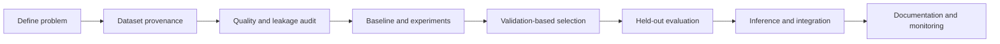

<div align="center">

# Wafa Bila Syaefurokhman

**AI / Machine Learning Engineer · Computer Vision · Android Development**

*Building reliable machine learning systems and turning research into practical software.*

[](https://www.linkedin.com/in/wafa-bila-syaefurokhman)
[](https://www.kaggle.com/wafabila)
[](mailto:menstruesalvation@gmail.com)
[](https://www.instagram.com/syfrkhmn.z)


</div>

---

## About Me

I'm an Informatics Engineering student at **Universitas Darussalam Gontor (UNIDA Gontor)** and an alumnus of **Pondok Modern Darussalam Gontor (Class of 2023)**. My work focuses on applied **machine learning**, **computer vision**, and **Android engineering**, with an interest in carrying research beyond experiments into usable applications.

My workflow spans problem framing, dataset provenance and auditing, leakage-aware evaluation, model development, inference optimization, and integration with APIs or mobile interfaces. I also explore **agentic AI** and the engineering of tool-integrated intelligent systems.

- **Primary interests:** AI/ML engineering, computer vision, multimodal perception, and on-device AI.
- **Research focus:** real-time human activity recognition from aerial video using pose estimation and temporal neural networks.
- **Software focus:** Python/PyTorch, Kotlin/Android, FastAPI, React/TypeScript, and ONNX Runtime.
- **Engineering priorities:** reproducibility, honest evaluation, clear documentation, and deployment-oriented design.

> I care about whether a system can be evaluated, understood, reproduced, and used—not only whether a model can be trained.

## Selected Engineering Work

The projects below represent different stages of research and engineering. **Prototype**, **research**, and **evaluated** are intentionally distinguished; not every project is a production deployment.

<table>
<tr>
<td width="50%" valign="top">

### UAV Human Activity Recognition
**Research · Computer Vision · Temporal Modeling**

Aerial-video activity recognition pipeline combining person/pose detection, sequence modeling, and optimized inference.

- YOLO-based person and pose extraction
- Temporal neural networks for skeleton sequences
- ONNX Runtime experimentation
- Cross-view evaluation and real-time constraints

[Repository](https://github.com/MENSTRUE/face_recognition_and_gesture)

</td>
<td width="50%" valign="top">

### EggSizeGrader
**Evaluated prototype · Object Detection**

End-to-end image-based egg detection and dataset-defined size classification, connected to a usable web interface.

- YOLOv8n, FastAPI, React/TypeScript
- 318 annotated images with group-disjoint splitting
- Reported held-out **mAP@50: 91.13%**
- Reported held-out **mAP@50–95: 84.28%**

*Visual classes are not calibrated physical measurements.*

[Repository](https://github.com/MENSTRUE/EggSize-Grader)

</td>
</tr>
<tr>
<td width="50%" valign="top">

### LeafDoctor Lite
**Prototype · Agricultural Computer Vision**

Plant disease image classification with a lightweight architecture and an inference API.

- MobileNetV3-Small / PyTorch
- Multi-class image classification
- FastAPI model-serving integration
- Application-oriented inference workflow

[Repository](https://github.com/MENSTRUE/LeafDoctor-Lite)

</td>
<td width="50%" valign="top">

### MilestonePay AI
**Prototype · AI-Assisted Web Application**

Milestone-based freelance payment workflow prototype with role-aware interactions and AI-assisted coordination concepts.

- FastAPI, React, TypeScript
- Backend validation and permissions
- Milestone and request workflows
- Payment integration considerations

*Payment connectivity and production financial safeguards are not presented as deployed capabilities.*

[Repository](https://github.com/MENSTRUE/milestonepay-ai)

</td>
</tr>
</table>

### Additional Research & Projects

| Project | Focus | Technical emphasis |
|:--|:--|:--|
| **Novel Chemicals Discovery Agent** | Molecular data and AI-assisted chemical discovery | RDKit, molecular preprocessing, scientific data validation, agentic workflows |
| [**RicePest Spotter**](https://github.com/MENSTRUE/RicePest-Spotter) | Agricultural image understanding | Computer vision, dataset preparation, model integration |
| [**HarvestForecast**](https://github.com/MENSTRUE/HarvestForecast) | Agricultural forecasting | Regression, preprocessing, evaluation |
| **FishSizeEstimate** | Underwater visual representation learning | Stereo ROS bag data, self-supervised CNN pretraining, calibration analysis |

**FishSizeEstimate research note:** All **11 available ROS recordings** were traversed in a visual-pretraining experiment; **10,405 decoded frames** were used across **331 optimizer steps**. This trained an image **representation encoder**, **not** a calibrated model predicting fish length in centimeters. The upstream Dataset B archive is incomplete.

## Research & Engineering Approach

I structure ML work so that experimental evidence and application development remain traceable:



**What this means in practice**

- **Data quality:** inspect labels, source licenses, duplicate samples, missing values, and collection artifacts.
- **Evaluation discipline:** separate model selection from held-out testing; use group- or time-aware splits where the problem requires them.
- **Model engineering:** record hyperparameters, dependencies, artifacts, and observed limitations.
- **Deployment readiness:** expose inference through APIs, Android experiences, or efficient runtimes when appropriate.
- **Responsible claims:** distinguish proof-of-concept results from deployment evidence and avoid reporting unmeasured accuracy.

## Technical Stack

<table>
<tr><th align="left">Area</th><th align="left">Tools and technologies</th></tr>
<tr><td><b>AI & Machine Learning</b></td><td>Python · PyTorch · TensorFlow · scikit-learn · Transformers · RDKit</td></tr>
<tr><td><b>Computer Vision</b></td><td>OpenCV · YOLO · MediaPipe · Detection · Segmentation · Pose Estimation</td></tr>
<tr><td><b>Model Inference</b></td><td>ONNX Runtime · Model optimization · CPU/GPU inference</td></tr>
<tr><td><b>Android</b></td><td>Kotlin · Java · Android Studio · Android SDK · Jetpack Compose · Firebase</td></tr>
<tr><td><b>Backend & Web</b></td><td>FastAPI · Pydantic · REST APIs · React · TypeScript · Vite</td></tr>
<tr><td><b>Data & MLOps</b></td><td>NumPy · Pandas · Jupyter · Kaggle · MLflow · Prometheus · Grafana</td></tr>
<tr><td><b>Agentic AI</b></td><td>LangChain · LangGraph · LLM integration · Tool calling</td></tr>
<tr><td><b>Development</b></td><td>Git · GitHub · Docker · Linux · VS Code · Testing · Documentation</td></tr>
</table>

<div align="center">


</div>

## GitHub Activity & Contributions

*The cards below are generated by third-party services. They reflect public GitHub activity and may occasionally be unavailable; they are not a substitute for project documentation.*

<div align="center">


</div>

### Contribution Animation

The animation below appears **only if** the profile repository publishes the generated SVG files to its `output` branch. If those files do not exist yet, the image will not render; it is optional and does not affect the rest of this README.

<div align="center">

<picture>
  <source media="(prefers-color-scheme: dark)" srcset="https://raw.githubusercontent.com/MENSTRUE/MENSTRUE/output/github-contribution-grid-snake-dark.svg" />
  <source media="(prefers-color-scheme: light)" srcset="https://raw.githubusercontent.com/MENSTRUE/MENSTRUE/output/github-contribution-grid-snake.svg" />
  
</picture>

</div>

<details>
<summary><b>How the contribution animation is generated</b></summary>

Add the following GitHub Actions workflow to **your profile repository** at `.github/workflows/snake.yml` if it is not already configured:

```yaml
name: Generate contribution snake

on:
  schedule:
    - cron: "0 0 * * *"
  workflow_dispatch:

permissions:
  contents: write

jobs:
  generate:
    runs-on: ubuntu-latest
    steps:
      - uses: Platane/snk/svg-only@v3
        with:
          github_user_name: MENSTRUE
          outputs: |
            dist/github-contribution-grid-snake.svg
            dist/github-contribution-grid-snake-dark.svg?palette=github-dark
      - uses: crazy-max/ghaction-github-pages@v4
        with:
          target_branch: output
          build_dir: dist
        env:
          GITHUB_TOKEN: ${{ secrets.GITHUB_TOKEN }}
```

This workflow **publishes** the generated images to the `output` branch; GitHub Actions must be enabled and have permission to write repository contents. Review external actions before enabling them.

</details>

## Learning & Collaboration

I'm especially interested in collaborating on **computer vision**, **ML engineering**, **AI-assisted applications**, and **Android/on-device AI**. I value technically grounded projects with clear problem definitions, measurable outcomes, and reproducible implementations.

For collaborations, research discussions, or relevant engineering opportunities, feel free to reach out through [LinkedIn](https://www.linkedin.com/in/wafa-bila-syaefurokhman) or [email](mailto:menstruesalvation@gmail.com).

<div align="center">

---

**Research-minded. Engineering-focused. Always improving.**

</div>
